# Domain model diagrams

## Legend

An example, cut from the `Session` and `Workstream` diagrams. It has every kind of line and line end:

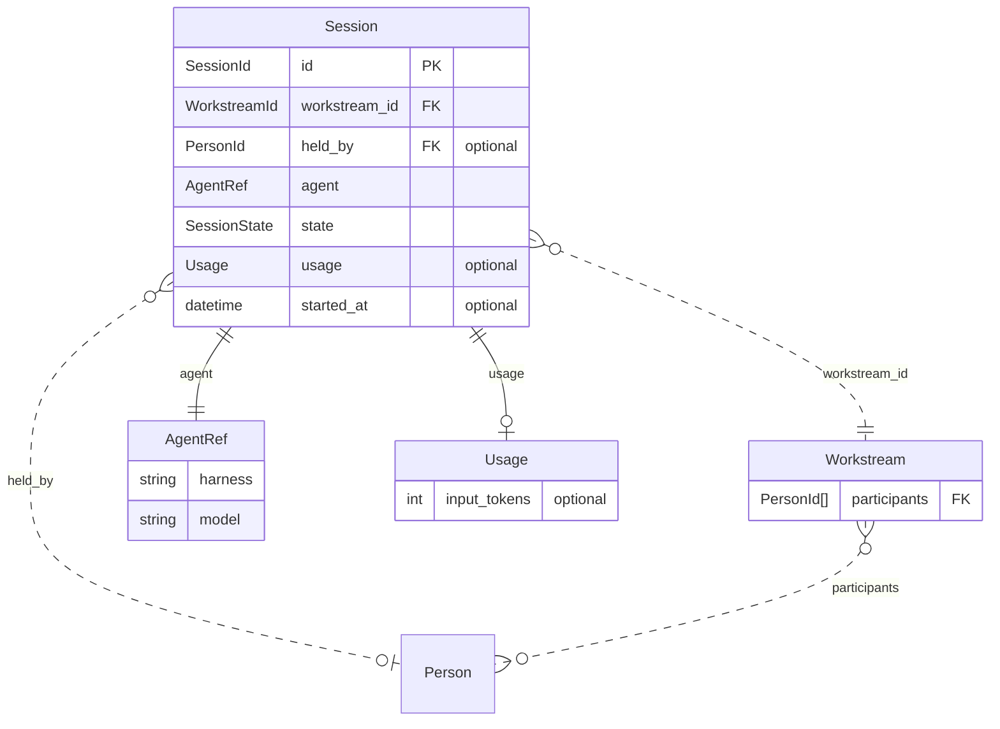

### Boxes

| Shape | Meaning |
|---|---|
| Box with a list of fields | A model, drawn in full. In a record's own diagram, the record and every value object it contains. |
| Box with a name only | Another record, drawn only to show the line to it. It has its own diagram below. |
| Box colour | Nothing. Mermaid picks the colours. |

### Lines

| Line | Meaning |
|---|---|
| Solid | Contains: one model holds the other in the field the label names. The other is a value object, stored only inside its owner, so the owner's end always shows two bars: exactly one owner. |
| Dashed | Refers to by ID: the model with the field the label names (marked `FK`) holds the other record's ID. |

### Line ends

| End (as drawn) | Meaning |
|---|---|
| Two bars | exactly one |
| A circle and a bar | zero or one: the field is optional |
| A circle and a crow's foot | zero or many: the field is a list, or many records may hold the same ID |

### Reading a line

| Example | Reads as |
|---|---|
| Dashed from `Session` to `Workstream`, labelled `workstream_id`: two bars at `Workstream`, a circle and a crow's foot at `Session` | Each session refers to exactly one workstream, in `workstream_id`. A workstream has zero or many sessions. The end next to a box says how many of that box the box at the other end has. |
| Solid from `Session` to `Usage`, labelled `usage`: two bars at `Session`, a circle and a bar at `Usage` | A session contains zero or one `Usage`, in `usage`. Each `Usage` belongs to exactly one session. |
| Dashed from `Workstream` to `Person`, labelled `participants`: a circle and a crow's foot at each end | A workstream refers to zero or many people, in the list `participants`. A person may be a participant in zero or many workstreams. |

### Fields

| Column or type | Meaning |
|---|---|
| First column | The field's type. |
| Second column | The field's name. |
| `PK` | The record's own ID. |
| `FK` | The ID of another record. A dashed line leads to it. |
| `"optional"` | The field may be absent or null. A list is never marked: it may be empty. |
| `SessionId`, `WorkstreamId`, ... | An ID of that record: `<prefix>_<ULID>`. Prefixes are in the table. |
| `Type[]` | A list of `Type`. |
| A capitalised type with no box, such as `SessionState` | An enum. Its values are in the schema. |
| `A_B_C` | One of several models: `A`, `B`, or `C`. Each has a solid line. |
| `datetime` | A point in time, always in UTC. |
| `const` | A fixed value: the schema version, or the `kind` that tells union members apart. |
| `string`, `int`, `float`, `bool` | As named. |

## About this file

Generated from `schemas/domain.schema.json` by `make -C domain_models schemas`. Do not edit.

A **record** is stored on its own and has an ID. Every other model is a **value object**, stored
only inside a record. Every record also has `schema_version`, `created_at`, `updated_at`, which the per-record diagrams leave out.

## Records

| Record | ID prefix | Belongs to | Also refers to |
|---|---|---|---|
| `Person` | `usr_` | — | — |
| `Project` | `prj_` | — | — |
| `Membership` | `mbr_` | `Person`, `Project` | — |
| `Epic` | `ep_` | `Project` | `Ticket` |
| `Workstream` | `ws_` | `Project`, `Ticket` | `Convo`, `Epic`, `Person`, `Schedule`, `Session`, `WorkstreamVm` |
| `WorkstreamEvent` | `wse_` | `Workstream` | `Convo`, `Person`, `Session` |
| `Ticket` | `tk_` | `Project` | `Epic`, `Workstream` |
| `Schedule` | `sch_` | `Person`, `Project` | — |
| `Session` | `ses_` | `Workstream` | `Person`, `Worker`, `WorkstreamVm` |
| `WorkstreamVm` | `vm_` | `Worker`, `Workstream` | — |
| `Worker` | `wkr_` | — | — |
| `Convo` | `cv_` | `Project` | — |
| `ConvoLink` | `cvl_` | `Convo`, `Workstream` | `Person`, `Session` |
| `ConvoEvent` | `cve_` | `Convo` | `Person`, `Session` |

Value objects: `AgentRef`, `Approval`, `CapabilityManifest`, `ComponentActor`, `ExternalActor`, `ExternalIdentity`, `ImageRef`, `NetworkRule`, `PersonActor`, `PullRequestInfo`, `Repository`, `ResourceMount`, `Resources`, `SessionActor`, `Source`, `StoryRef`, `TrackerMirror`, `Usage`, `WorkerOffer`.

## Overview

Records only. A line joins a record to a record it belongs to: a required ID field holding one ID. A record with no line out is a root. Every line here is a reference by ID, even where Mermaid draws one solid at a crossing.

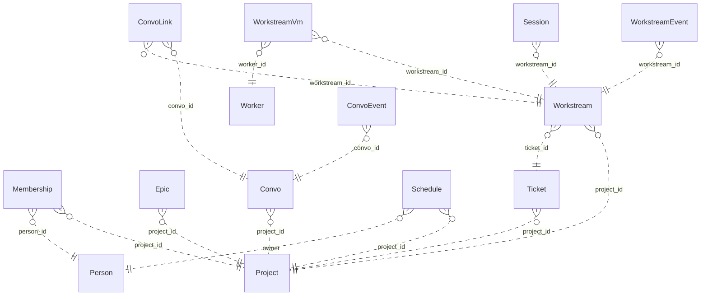

## Each record

### Person

Solid lines embed a value object; dashed lines refer to another record by ID.

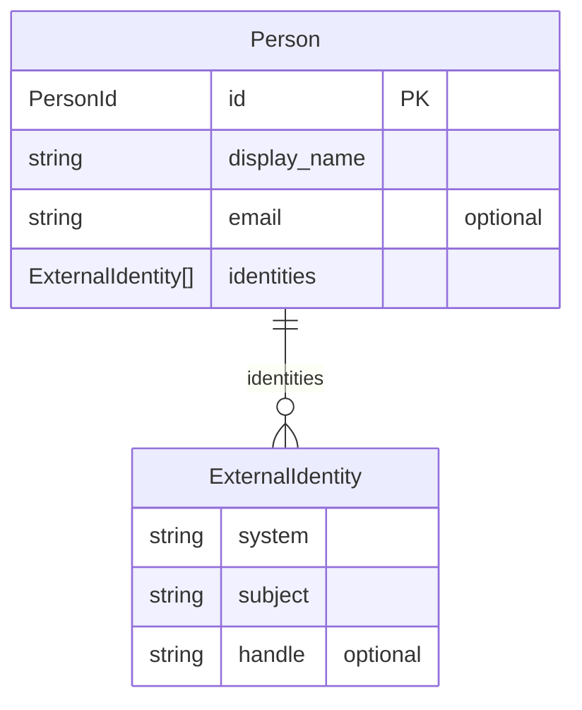

### Project

Solid lines embed a value object; dashed lines refer to another record by ID.

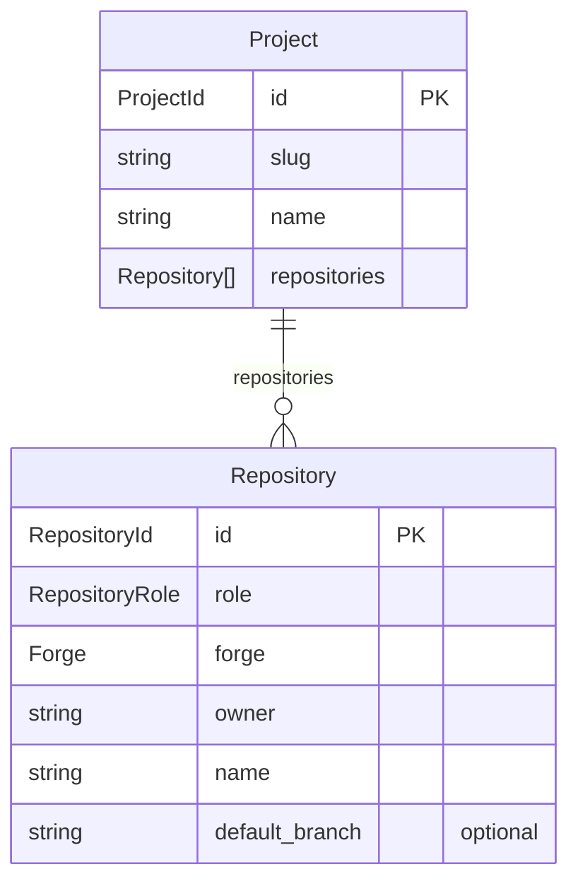

### Membership

Solid lines embed a value object; dashed lines refer to another record by ID.

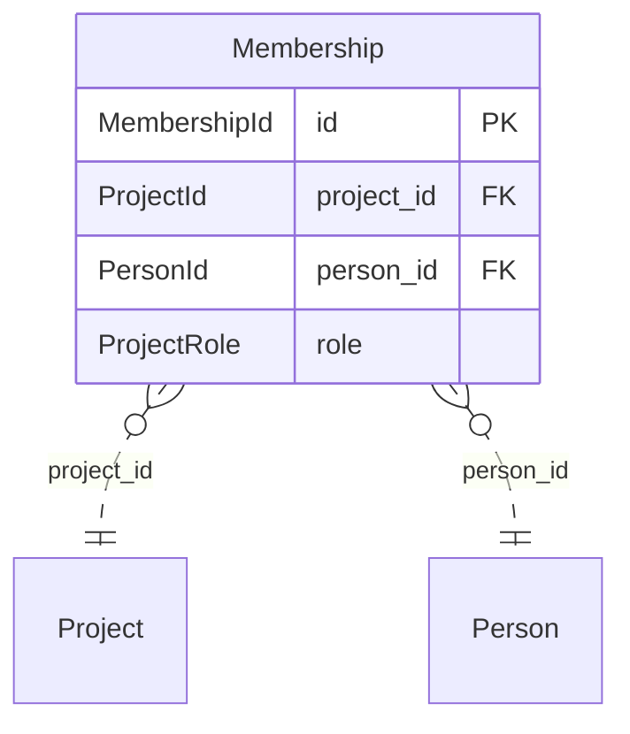

### Epic

Solid lines embed a value object; dashed lines refer to another record by ID.

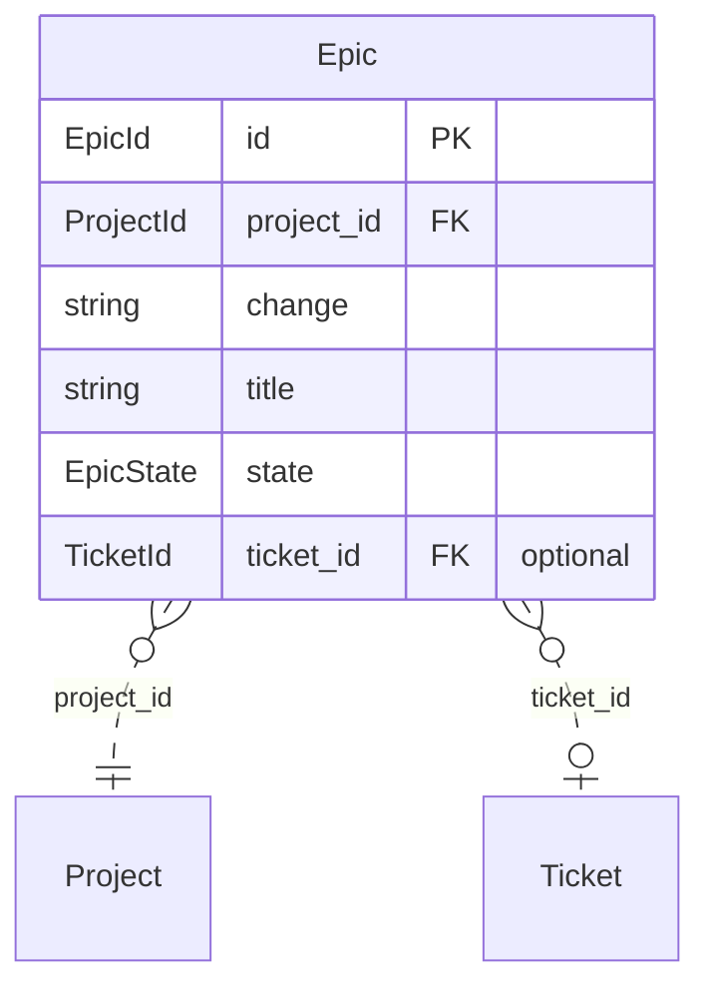

### Workstream

Solid lines embed a value object; dashed lines refer to another record by ID.

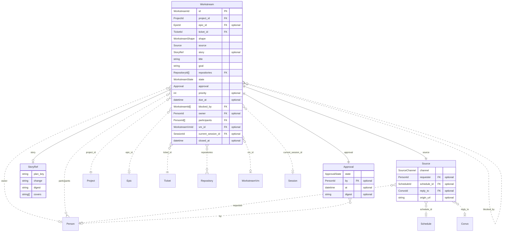

### WorkstreamEvent

Solid lines embed a value object; dashed lines refer to another record by ID.

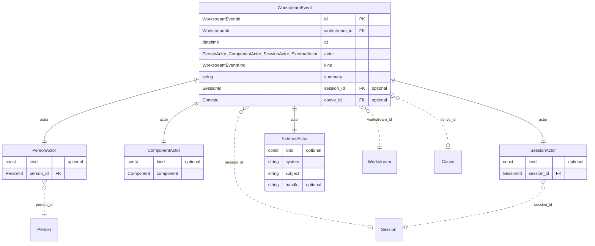

### Ticket

Solid lines embed a value object; dashed lines refer to another record by ID.

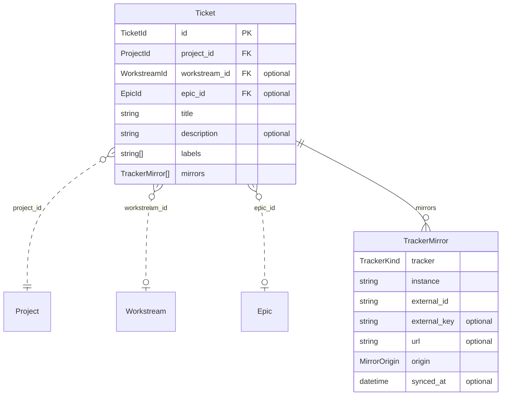

### Schedule

Solid lines embed a value object; dashed lines refer to another record by ID.

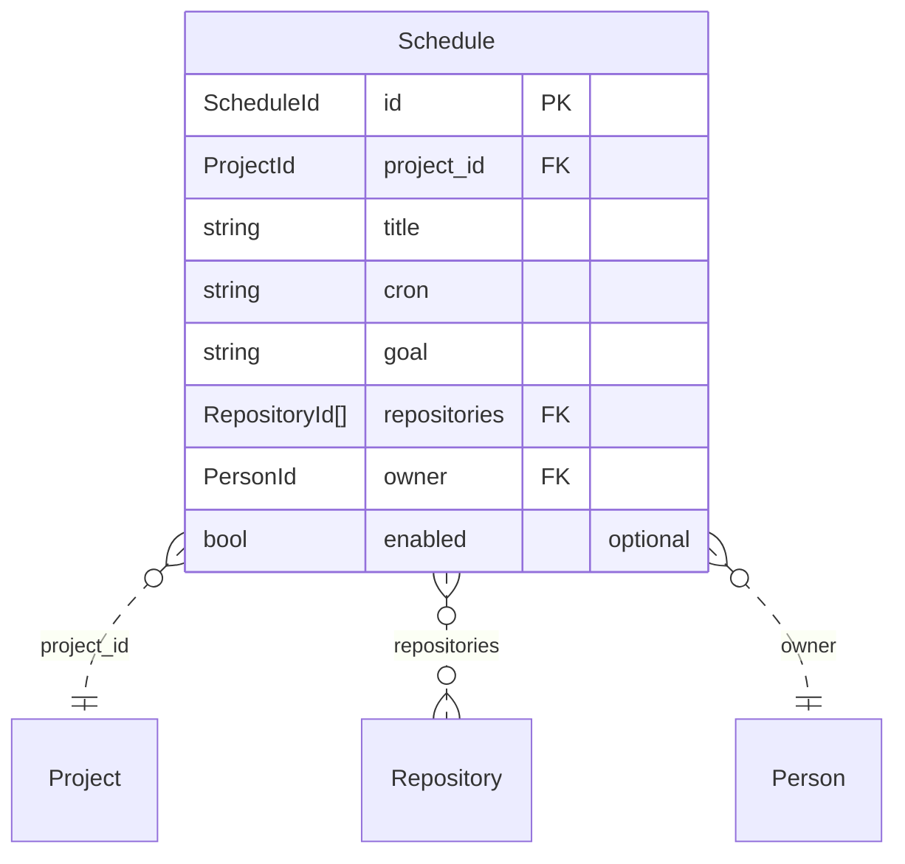

### Session

Solid lines embed a value object; dashed lines refer to another record by ID.

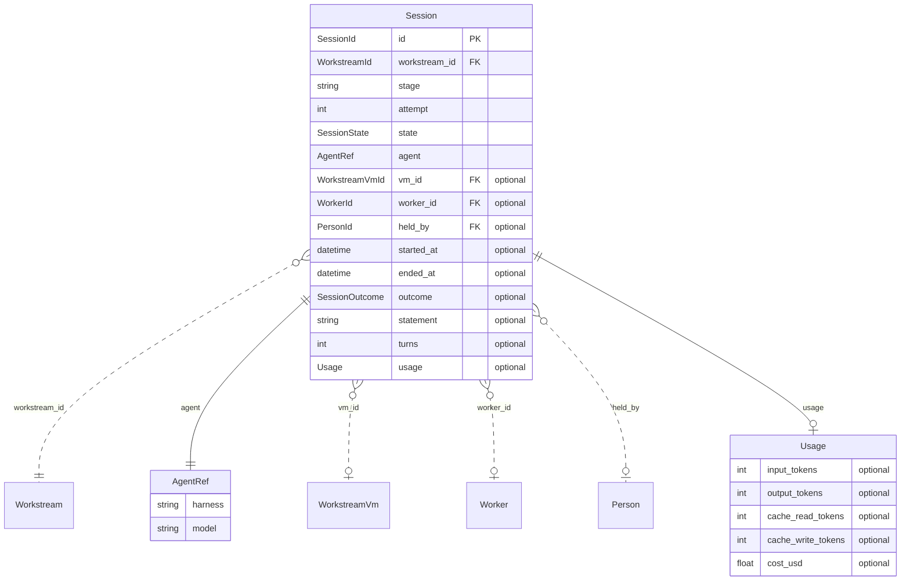

### WorkstreamVm

Solid lines embed a value object; dashed lines refer to another record by ID.

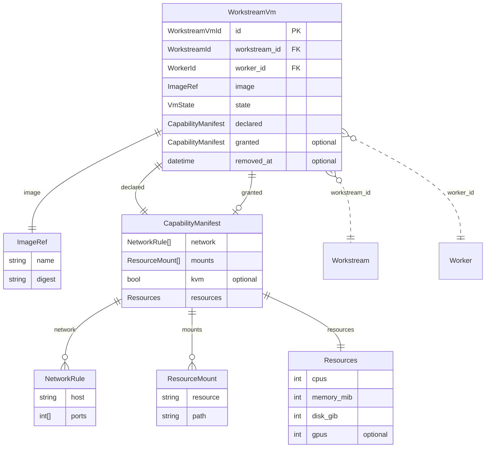

### Worker

Solid lines embed a value object; dashed lines refer to another record by ID.

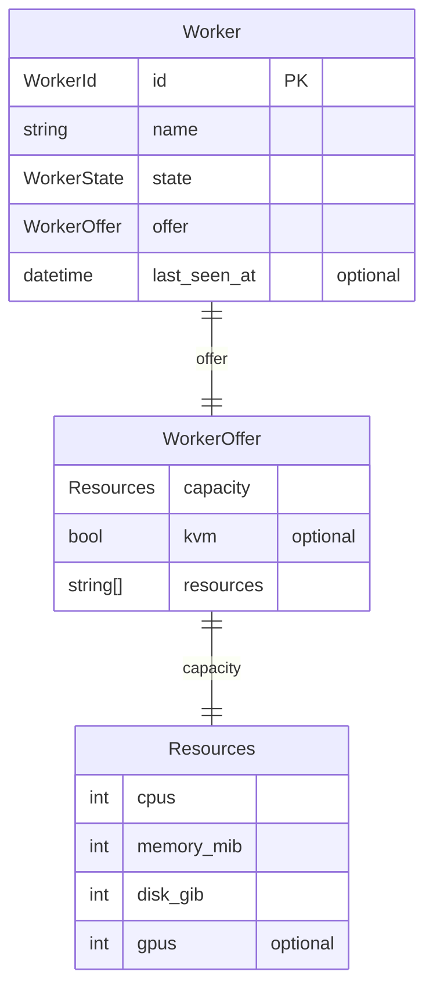

### Convo

Solid lines embed a value object; dashed lines refer to another record by ID.

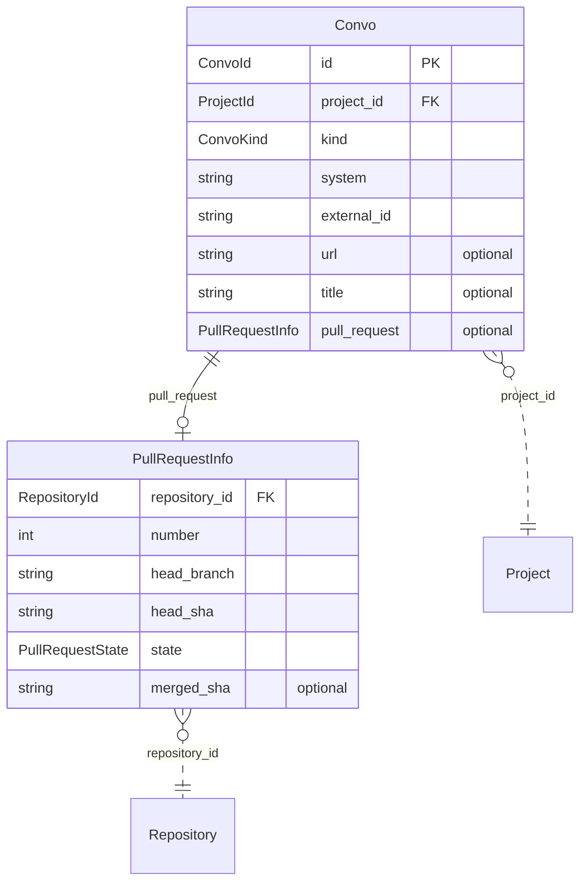

### ConvoLink

Solid lines embed a value object; dashed lines refer to another record by ID.

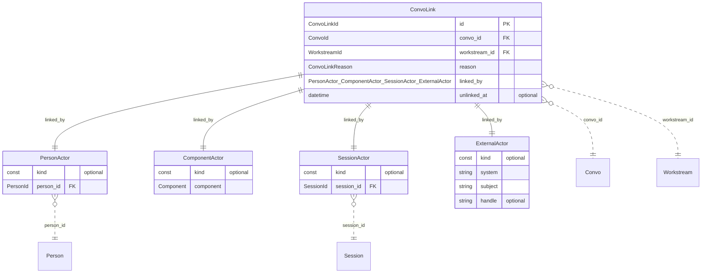

### ConvoEvent

Solid lines embed a value object; dashed lines refer to another record by ID.

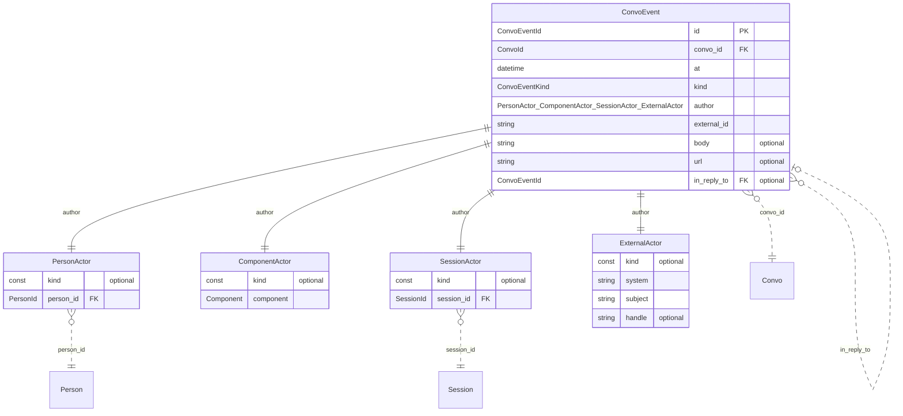
