# Domain model diagrams

## Legend

### Lines

| Symbol | Name | Meaning |
|---|---|---|
| 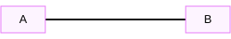 | **Contains** | A holds B inside it, in the field the label names. B is a value object: it has no ID and is stored only as part of A. |
| 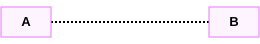 | **Refers to by ID** | A has a field, marked `FK`, that holds the ID of record B. The label names the field. |

### Line ends

| Symbol | Name | Meaning |
|---|---|---|
| 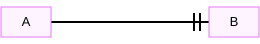 | **Exactly one** | Each A has exactly one B. The field is required. |
| 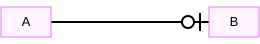 | **Zero or one** | Each A has at most one B. The field may be null or left out. |
| 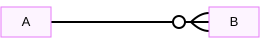 | **Zero or many** | Each A has any number of B: the field is a list, or many A hold the same B. |
| 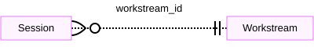 | **Reading both ends** | Read each end from the box at the other end. Each `Session` has exactly one `Workstream`, in `workstream_id`. Each `Workstream` has zero or many `Session`s. |

### Boxes

| Symbol | Name | Meaning |
|---|---|---|
| 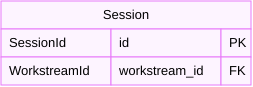 | **Model, in full** | A record or value object with all its fields. Each record has a diagram of its own. |
| 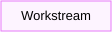 | **Other record** | Drawn by name only, to show a line to it. Its fields are in its own diagram. |
|  | **Box colour** | Means nothing. Mermaid picks the colours. |

### Fields

| Symbol | Name | Meaning |
|---|---|---|
|  | **Own ID** | The record's own ID. |
|  | **Reference** | Holds the ID of another record, or a list of them. A dashed line leads to that record. |
| 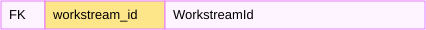 | **Name** | The field's name. Line labels use it. |
| 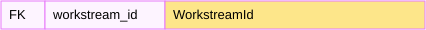 | **Type** | The field's type, written as in Python. `WorkstreamId` is an ID of a `Workstream`: `<prefix>_<ULID>`, with the prefixes in the records table. |
| 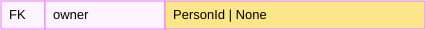 | **May be null** | `| None`: the value may be null. With no `=`, the field must still be given. |
|  | **Has a default** | `= value`: the field may be left out, and then has that value. |
| 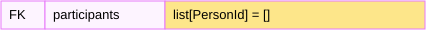 | **List** | A list of the type in brackets. |
| 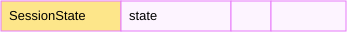 | **Enum** | A type with no box of its own. Its values are in the schema. |
|  | **One of several** | The field holds one of the models joined by `|`. Each has a solid line. |
|  | **Fixed value** | Always this value: here, the `kind` that tells the members of a union apart. |
|  | **Time** | A `datetime` is always in UTC. |

## About this file

Generated from `schemas/domain.schema.json` by `make -C domain_models schemas`. Do not edit.

A **record** is stored on its own and has an ID. Every other model is a **value object**, stored
only inside a record. Every record also has `schema_version`, `created_at`, `updated_at`, which the per-record diagrams leave out.

## Records

| Record | ID prefix | Belongs to | Also refers to |
|---|---|---|---|
| `Person` | `usr_` | — | — |
| `Project` | `prj_` | — | — |
| `Membership` | `mbr_` | `Person`, `Project` | — |
| `Epic` | `ep_` | `Project` | `Ticket` |
| `Workstream` | `ws_` | `Project`, `Ticket` | `Convo`, `Epic`, `Person`, `Schedule`, `Session`, `WorkstreamVm` |
| `WorkstreamEvent` | `wse_` | `Workstream` | `Convo`, `Person`, `Session` |
| `Ticket` | `tk_` | `Project` | `Epic`, `Workstream` |
| `Schedule` | `sch_` | `Person`, `Project` | — |
| `Session` | `ses_` | `Workstream` | `Person`, `Worker`, `WorkstreamVm` |
| `WorkstreamVm` | `vm_` | `Worker`, `Workstream` | — |
| `Worker` | `wkr_` | — | — |
| `Convo` | `cv_` | `Project` | — |
| `ConvoLink` | `cvl_` | `Convo`, `Workstream` | `Person`, `Session` |
| `ConvoEvent` | `cve_` | `Convo` | `Person`, `Session` |

Value objects: `AgentRef`, `Approval`, `CapabilityManifest`, `ComponentActor`, `ExternalActor`, `ExternalIdentity`, `ImageRef`, `NetworkRule`, `PersonActor`, `PullRequestInfo`, `Repository`, `ResourceMount`, `Resources`, `SessionActor`, `Source`, `StoryRef`, `TrackerMirror`, `Usage`, `WorkerOffer`.

## Overview

Records only. A line joins a record to a record it belongs to: a required ID field holding one ID. A record with no line out is a root. Every line here is a reference by ID, even where Mermaid draws one solid at a crossing.

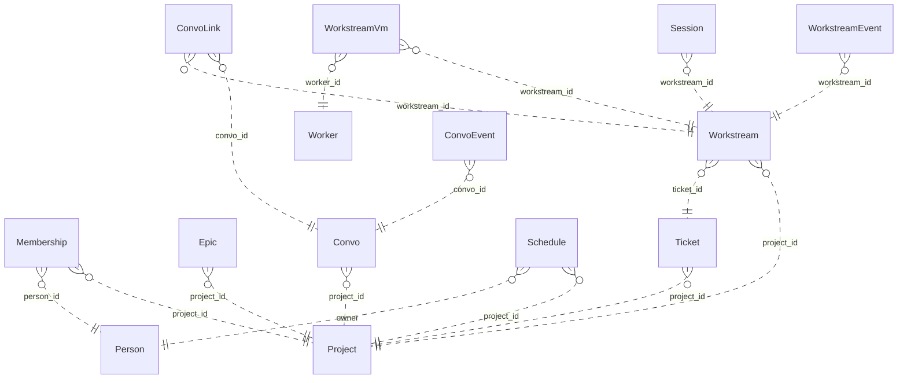

## Each record

### Person

A human who uses the system: plans, approves, steers, or asks for work.

Used to attribute every action, to grant roles in projects through memberships, and to recognise the same person in other systems through their external identities.

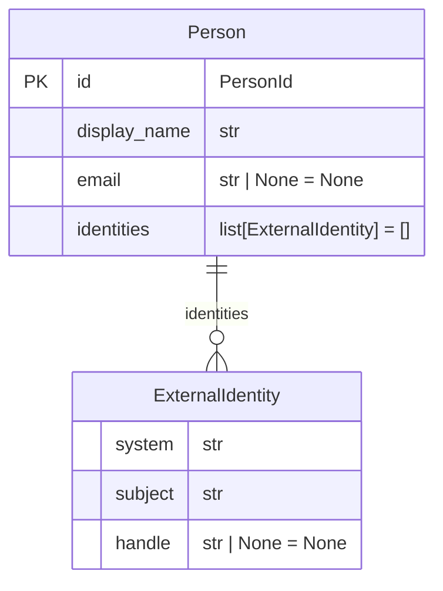

### Project

A body of work: its repositories, its spec store, and its members.

Everything else belongs to a project. It scopes who may see and do what, and which repositories sessions may change.

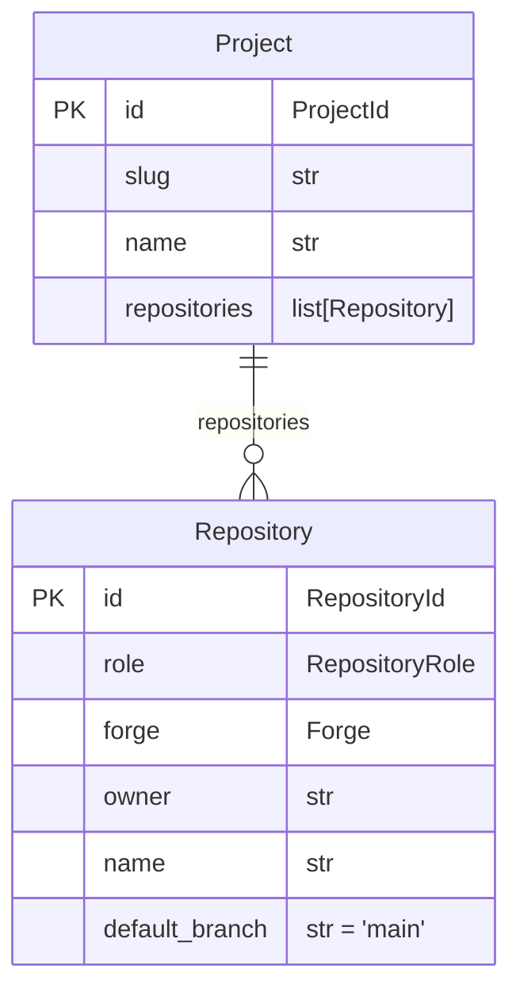

### Membership

One person's role in one project.

Used to decide what that person may see and do in the project. A person has at most one membership per project.

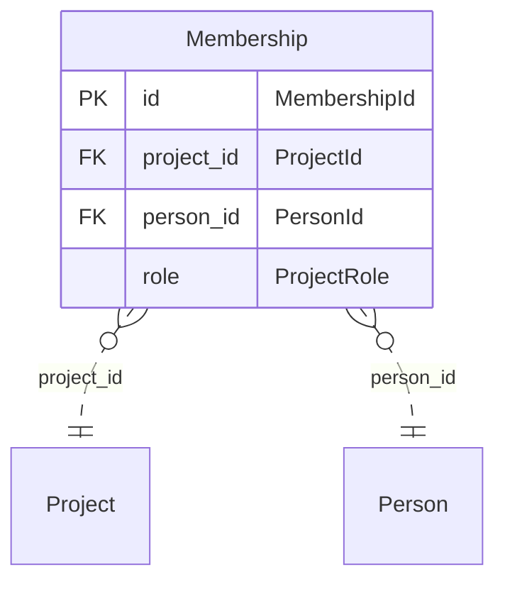

### Epic

The workstreams that come from one plan DAG: the breakdown of one OpenSpec change.

Used to follow the progress of a plan as a whole. An epic is never executed itself: it is done when all its workstreams are.

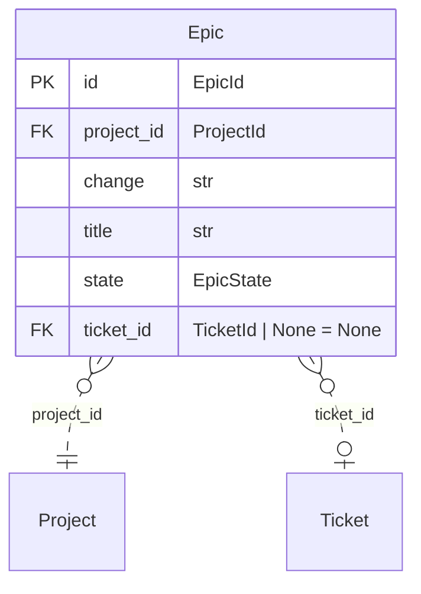

### Workstream

One unit of work, from the moment it is asked for until it is done or cancelled.

A planned story, an ad-hoc ask, or a scheduled run. The central record: sessions run for it, its ticket shows it in trackers, its convos carry the discussion about it, and its events record everything that happened to it.

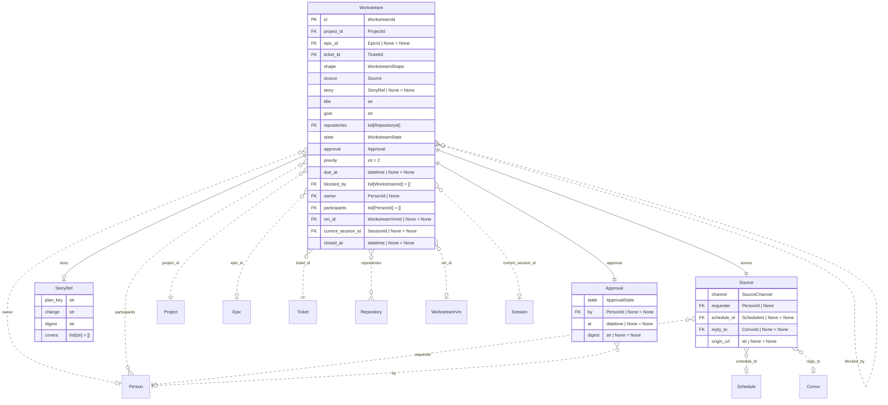

### WorkstreamEvent

One entry in a workstream's history.

A state change, an approval, a session starting or ending, a steer, an escalation, or a decision. Used to show people what happened and why, and to give later sessions that context. Append-only: never changed or deleted.

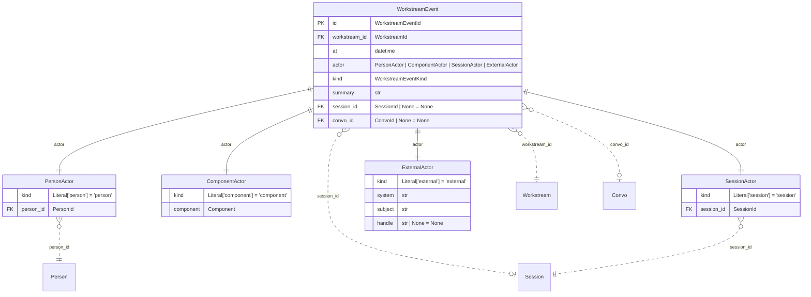

### Ticket

The tracker record of a workstream or an epic, kept in the system's own database.

People find and discuss work through it, and it is mirrored to external trackers (Huly, Jira, Linear) in either direction. A ticket has no state of its own: its state is its subject's, and each mirror maps that state to its tracker's states.

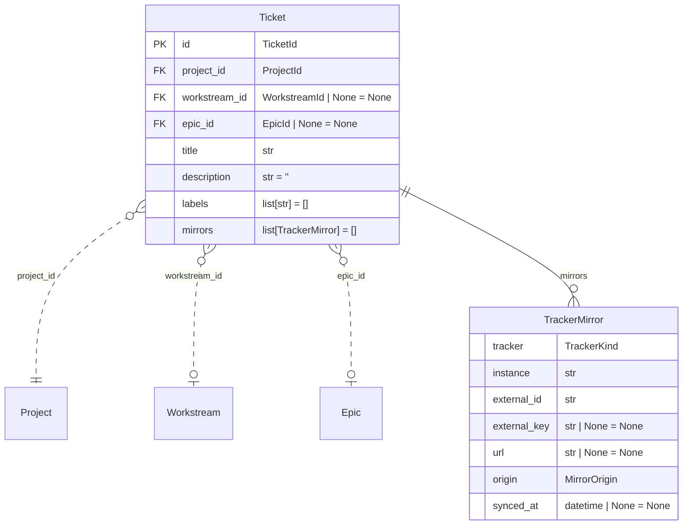

### Schedule

A recurring request: each time it fires, it creates a scheduled workstream with its goal.

Used for cron-like work, such as dependency updates or nightly checks. PROVISIONAL: cron ownership is open (review item 13).

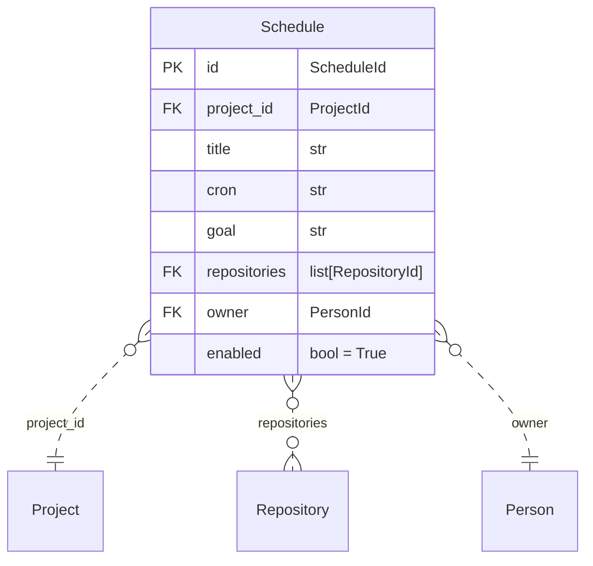

### Session

One agent conversation with one purpose, run in its workstream's VM.

For example, drafting a change, reviewing it, or addressing review comments. The unit a worker runs and acp-broker relays; a retry is a new session. Records who held it, how it ended, and what it cost.

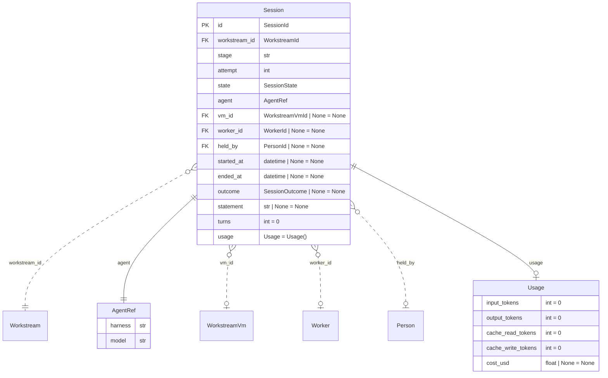

### WorkstreamVm

The one VM a workstream's sessions run in, from its first session until the workstream closes.

Records which worker runs it, the image it started from, and the capabilities it asked for and was granted. Untrusted: everything the agent runs is inside it.

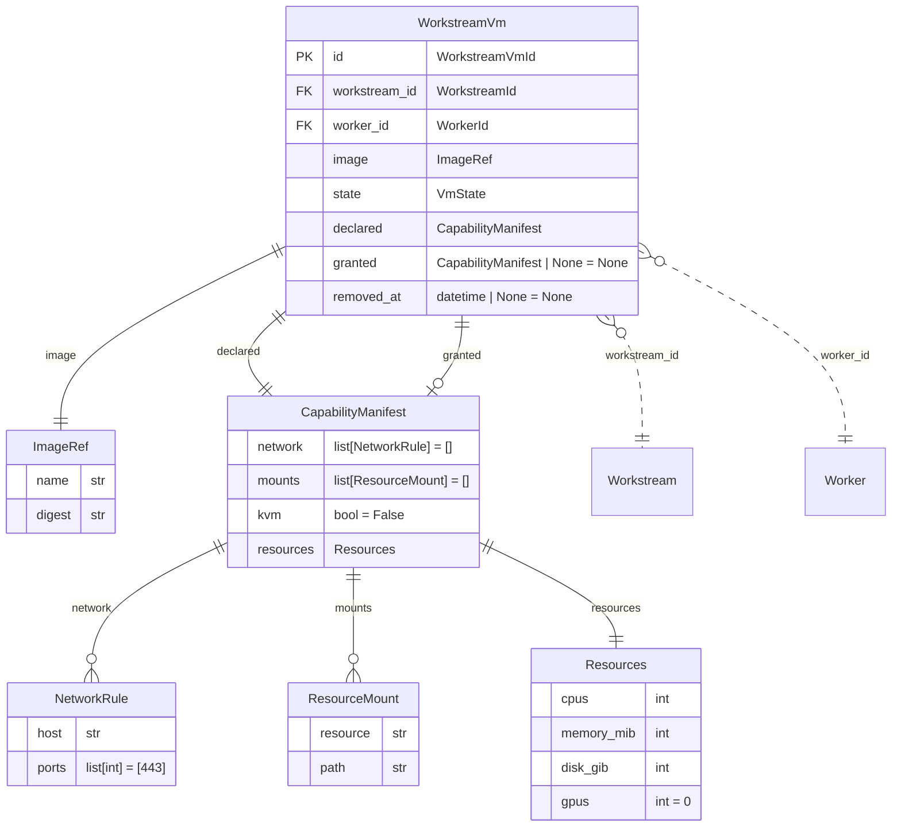

### Worker

A trusted machine that runs workstream VMs.

Used to place each VM on a worker that offers every capability and resource the VM needs, and to know which workers are online.

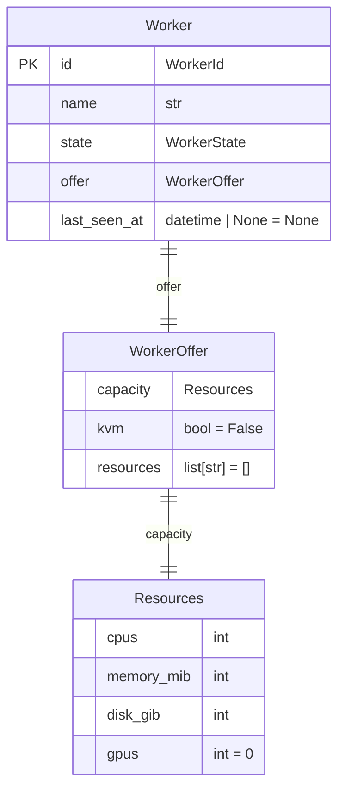

### Convo

A conversation outside the system that bears on one or more workstreams.

A pull request, a chat thread, an email chain, or the comments on a tracker issue. Used to route follow-up events to the workstreams attached to it, and to send replies back where they were asked.

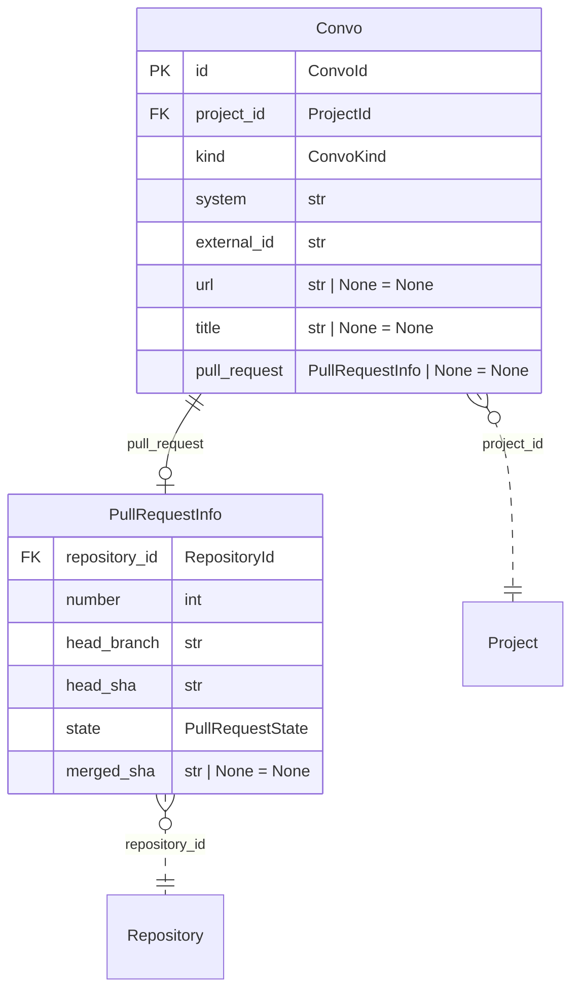

### ConvoLink

Attaches one convo to one workstream, and says why.

The convo started the workstream, the workstream created it, or it was attached later. Follow-up events in the convo go to every workstream attached to it.

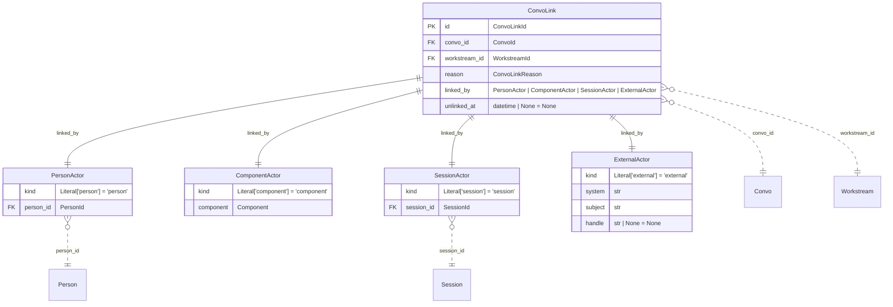

### ConvoEvent

One event in a convo: a message, a review comment or verdict, a CI result, a state or label change.

Used to start and inform the sessions of the workstreams attached to the convo. Append-only. Its body is untrusted.

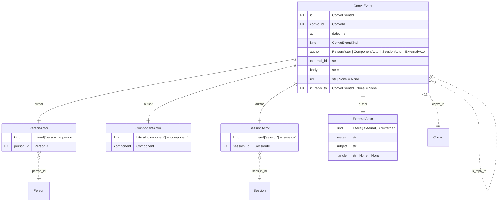
